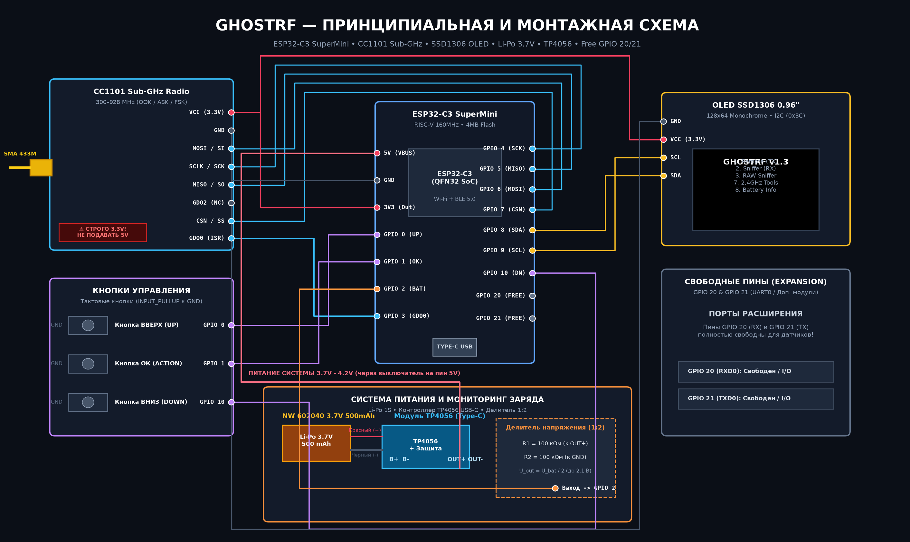

# Портативный RF-Мультитул 433.92 МГц на ESP32-C3 + OLED 0.96" (SSD1306) + CC1101

Компактная карманная версия радиоустройства с OLED-дисплеем 0.96" I2C для работы с радиоустройствами 433 МГц (радиорозетки, умные реле, беспроводные звонки, датчики и пульты).

---

## 🛠 Новая схема подключения (Экономия пинов!)

Переход на OLED 0.96" по шине I2C освободил пины и уменьшил габариты устройства до размера спичечного коробка!



| Компонент | Вывод модуля | Пин ESP32-C3 | Назначение |
|---|---|---|---|
| **Питание** | VCC (OLED и CC1101) | **3.3V** | Питание 3.3 В |
| **Питание** | GND (OLED и CC1101) | **GND** | Общий провод |
| **OLED 0.96" I2C** | **SDA** | **GPIO 8** | Данные I2C (аппаратная шина) |
| **OLED 0.96" I2C** | **SCL** | **GPIO 9** | Тактирование I2C (аппаратная шина) |
| **CC1101 (SPI)** | **SCK / CLK** | **GPIO 4** | Тактирование SPI |
| **CC1101 (SPI)** | **MISO / SO** | **GPIO 5** | Данные от радиомодуля к ESP32 |
| **CC1101 (SPI)** | **MOSI / SI** | **GPIO 6** | Данные от ESP32 к радиомодулю |
| **CC1101 (SPI)** | **CSN / SS** | **GPIO 7** | Выбор чипа CC1101 |
| **CC1101 (SPI)** | **GDO0** | **GPIO 3** | Цифровой ввод/вывод радиосигнала (RX/TX) |
| **Кнопка ВВЕРХ** | Кнопка 1 -> GND | **GPIO 0** | Навигация вверх / Увеличение |
| **Кнопка ОК** | Кнопка 2 -> GND | **GPIO 1** | Короткое: ОК / Длинное (>0.75с): Главное меню |
| **Кнопка ВНИЗ** | Кнопка 3 -> GND | **GPIO 10** | Навигация вниз / Уменьшение |
| **Вольтметр АКБ** | Делитель 100к + 100к | **GPIO 2** | АЦП ADC1_CH2 (0-4.2V сглаженный замер батареи) |
| **Свободные выводы** | UART0 / Доп. модули | **GPIO 20, 21** | Свободны для пользовательских расширений |
| **Контроллер заряда** | Модуль TP4056 USB-C | **5V / GND** | Питание системы от аккумулятора Li-Po 3.7V |

*Контакты GPIO 20 и GPIO 21 свободны для ваших модификаций.*

---

## 📱 Функционал прошивки (GHOSTRF v1.3 — 9 Режимов)

### 1. Главное меню
* Четкий высококонтрастный интерфейс с динамической шапкой (индикатор заряда АКБ, Bluetooth-бейдж).
* 9 полнофункциональных режимов работы:
  1. `1. Remote (TX)` — передача сохраненных Sub-GHz радиокодов
  2. `2. Sniffer (RX)` — перехват протоколов фиксированного кода (PT2262, EV1527)
  3. `3. RAW Sniffer` — захват временных диаграмм OOK и декодер KeeLoq HCS200/300/301
  4. `4. Freq Analyzer` — частотомер с автолоком на несущую и замером пикового RSSI
  5. `5. RSSI Spectrum` — 32-канальный панорамный спектроанализатор с Peak Hold
  6. `6. Carrier / Jam` — генератор непрерывной несущей и аудиотона
  7. `7. 2.4GHz Tools` — Wi-Fi сканер, спектр каналов, Deauth Sniffer, BLE Radar, BLE Spammer, Wi-Fi Beacon Spam
  8. `8. Battery Info` — вольтметр аккумулятора с графическим баром, процентным индикатором и статусом зарядки
  9. `9. Settings` — статус Bluetooth BLE 5.0, системная информация, температура ядра
* Длинное удержание кнопки **ОК** (> 0.75 сек) из любого режима возвращает в Главное меню.

### 2. Пульт управления (Remote TX) и управление сигналами
* Список сохраненных сигналов во Flash-памяти NVS (до 20 сигналов).
* Нажатие **ОК** на любом сигнале открывает **меню действий сигнала**:
  * **1. Transmit (TX):** отправка сигнала в эфир с визуальной индикацией `>>> TRANSMITTING <<<` (можно нажимать многократно).
  * **2. Delete Signal:** удаление выбранного сигнала из памяти NVS со сдвигом списка и освобождением места.
  * **3. Back to List:** возврат в список без изменений.
* В шапке меню сигнала отображаются имя, частота и детали (HEX-код, количество RAW-импульсов или серийный номер KeeLoq).

### 3. Приемник и сканер эфира (RX Sniffer)
* Мониторинг эфира OOK/ASK на частоте 433.92 МГц с анимацией радара.
* Захват и мгновенная фиксация пакета (PT2262, EV1527 и др.):
  * **HEX-код** (например, `0x547A11`), **DEC-код**, количество бит (24b), номер протокола, длительность импульса в микросекундах (`us`).
* **Быстрые действия:**
  * **[OK]**: Сохранить в память Flash (NVS) под новым именем (`Dev #1`, `Dev #2`...).
  * **[ВВЕРХ]**: Мгновенно отправить пойманный код в эфир для проверки.
  * **[ВНИЗ]**: Сбросить и продолжить сканирование.

### 3. RAW-сниффер и декодер KeeLoq (SubGhz RAW Edge)
* Прямой аппаратный захват фронтов импульсов через прерывания микроконтроллера на выводе CC1101 `GDO0`.
* **Адаптивный шумоподавитель (Squelch Threshold):**
  * Отсекает паразитный тепловой шум эфира OOK, предотвращая ложные срабатывания при входе в режим.
  * Живой индикатор уровня сигнала (**Live RSSI Meter**) на экране с вертикальной отметкой порога шумоподавителя.
* **Автоматическое распознавание KeeLoq (HCS200 / HCS300 / HCS301):**
  * Серийный номер брелока (**Serial Number**: 28 бит).
  * Код нажатой кнопки (**Button Code**: 4 бита).
  * Зашифрованный динамический счетчик (**Encrypted Hopping Code**).
* **Для любых неизвестных сигналов и брелоков:**
  * Отображение количества импульсов и таймингов.
  * **Встроенный цифровой микро-осциллограф:** графическая визуализация формы пойманных импульсов прямо на экране OLED 128x64!
  * **[OK] Save:** сохранение RAW-сигнала в энергонезависимую память Flash (NVS)!
  * **[UP] TX Replay:** мгновенное воспроизведение пойманных импульсов в эфир!
  * **[DN] / X:** сбросить и продолжить захват.

### 4. Графический многодиапазонный RSSI Спектроанализатор с Peak Hold
* **Поддержка диапазонов частот:**
  * **433 МГц** (433.05 – 434.80 МГц)
  * **315 МГц** (314.00 – 316.00 МГц)
  * **868 МГц** (867.50 – 869.50 МГц)
* **Режим Peak Hold:** фиксация пиковых уровней сигнала горизонтальными метками с плавным затуханием.
* **Управление в спектре:**
  * **ВВЕРХ / ВНИЗ**: быстрое переключение диапазона частот.
  * **ОК (короткое)**: мгновенный сброс меток Peak Hold.
  * **ОК (удержание > 0.75 с)**: возврат в Главное меню.
* Высокая скорость сканирования 32 каналов без блокирующих задержек.
* В шапке в реальном времени отображается текущий диапазон и пиковый уровень сигнала в dBm.

### 5. Тест несущей частоты (CW Beacon)
* Непрерывная передача тестового радиосигнала на выбранной частоте и мощности.
* Проверка дальности, антенны и радиоприемников.

### 6. Настройки и системный монитор
* **Выбор частоты:** 433.920, 433.075, 433.420, 434.420, 434.775, 315.000 МГц.
* **Мощность передатчика (TX Power):** выбор уровня PA (-30 dBm, -10 dBm, 0 dBm, +10 dBm).
* **Порог шумоподавителя (RAW Squelch):** -85 dBm, -78 dBm (по умолчанию), -72 dBm, -65 dBm.
* **Очистка памяти (Clear NVS):** безопасный сброс всех сохранённых сигналов.
* **Инфо о системе:** тактовая частота ESP32-C3, свободная RAM, Flash, статус чипа CC1101.
* *Все настройки автоматически сохраняются в Flash (NVS) и восстанавливаются при перезагрузке!*

---

## 🎮 Управление (3 кнопки)

* **ВВЕРХ (`GPIO 0`)**: перемещение вверх по спискам.
* **ВНИЗ (`GPIO 2` или `GPIO 10`)**: перемещение вниз по спискам.
* **ОК / ДЕЙСТВИЕ (`GPIO 1`)**:
  * **Короткое нажатие**: выбор пункта, отправка команды, сохранение.
  * **Длинное удержание (> 0.75 сек)**: возврат в **Главное меню** из любого подменю!

---

## 📁 Модульная структура проекта (`src/`)

Кодовая база полностью рефакторена в неблокирующую модульную архитектуру:

* [src/config.h](file:///home/esrhunter/Документы/cc1101/src/config.h) — конфигурация пинов SPI/I2C, кнопок, таймингов антидребезга и частотных таблиц.
* [src/types.h](file:///home/esrhunter/Документы/cc1101/src/types.h) — структуры `RFCommand`, `SpectrumBand`, enum состояний `AppState` и событий `ButtonEvent`.
* [src/buttons.h](file:///home/esrhunter/Документы/cc1101/src/buttons.h) / [src/buttons.cpp](file:///home/esrhunter/Документы/cc1101/src/buttons.cpp) — неблокирующий конечный автомат (FSM) опроса кнопок без `delay()` и `while()`.
* [src/storage.h](file:///home/esrhunter/Документы/cc1101/src/storage.h) / [src/storage.cpp](file:///home/esrhunter/Документы/cc1101/src/storage.cpp) — менеджер NVS Preferences для энергонезависимого сохранения радиокоманд и настроек.
* [src/radio.h](file:///home/esrhunter/Документы/cc1101/src/radio.h) / [src/radio.cpp](file:///home/esrhunter/Документы/cc1101/src/radio.cpp) — уровень абстракции CC1101 + RCSwitch (RX, TX, генератор несущей, RSSI-сканирование).
* [src/ui.h](file:///home/esrhunter/Документы/cc1101/src/ui.h) / [src/ui.cpp](file:///home/esrhunter/Документы/cc1101/src/ui.cpp) — визуализация интерфейса на OLED SSD1306, включая многодиапазонный спектр с Peak Hold.
* [src/main.cpp](file:///home/esrhunter/Документы/cc1101/src/main.cpp) — диспетчер инициализации и неблокирующий цикл обработки событий.

---

## 🚀 Прошивка через PlatformIO

Подключите плату ESP32-C3 Super Mini по USB к ПК и выполните команду:

```bash
~/.platformio/penv/bin/pio run -t upload
```

---

## 🛠 Печатная плата (All-in-One PCB)

Вся документация, перечень компонентов (BOM с артикулами LCSC), принципиальная схема и руководство по сборке/заказу в EasyEDA и JLCPCB находятся в директории [`pcb/`](file:///home/esrhunter/Документы/cc1101/pcb/README.md):

* [pcb/README.md](file:///home/esrhunter/Документы/cc1101/pcb/README.md) — Обзор архитектуры и габариты платы.
* [pcb/BOM.md](file:///home/esrhunter/Документы/cc1101/pcb/BOM.md) / [pcb/BOM.csv](file:///home/esrhunter/Документы/cc1101/pcb/BOM.csv) — Полная спецификация компонентов с кодами LCSC для автоматической сборки (PCBA).
* [pcb/SCHEMATIC.md](file:///home/esrhunter/Документы/cc1101/pcb/SCHEMATIC.md) — Полная принципиальная электрическая схема всех узлов.
* [pcb/LAYOUT_GUIDELINES.md](file:///home/esrhunter/Документы/cc1101/pcb/LAYOUT_GUIDELINES.md) — Расчет 50-Омной ВЧ-линии, экранирование и трассировка.
* [pcb/easyeda_guide.md](file:///home/esrhunter/Документы/cc1101/pcb/easyeda_guide.md) — Пошаговое руководство по созданию проекта в EasyEDA и заказу на JLCPCB.

---

## 🖥 Кроссплатформенное приложение GHOSTRF Studio (`gui/`)

В папке [`gui/`](file:///home/esrhunter/Документы/cc1101/gui/README.md) находится графическое приложение на **Qt 6 / C++ (CMake)** для управления устройством с ПК:

* **📂 Менеджер сохранённых сигналов:** чтение всех параметров (частота, код HEX/DEC/BIN, битность, протокол, KeeLoq данные), интерактивный цифровой осциллограф, экспорт/импорт в формат Sub-GHz (`.sub`) и JSON бэкап.
* **📡 Передатчик и генератор:** отправка фиксированных кодов (EV1527, PT2262, Came, Nice), RAW-импульсов и генерация несущей частоты.
* **🎮 Дистанционное управление:** виртуальный пульт управления OLED-экраном устройства, live-сниффер эфира с мгновенным повтором в эфир (Replay TX) и сохранением в NVS.
* **💻 Консоль Serial:** мониторинг пакетов и ручной ввод команд.

### Запуск приложения:
```bash
./build/gui/GHOSTRF-Studio
```


