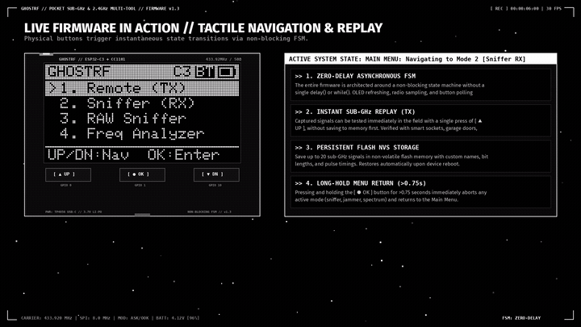
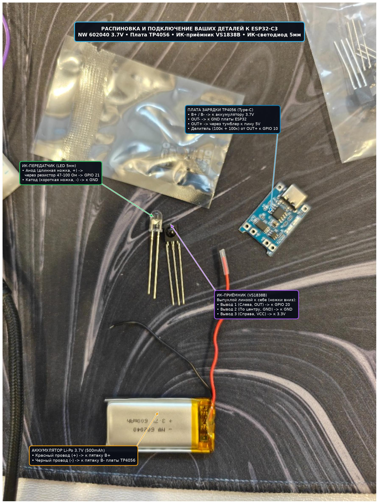

```
╔═══════════════════════════════════════════════════════════════════════════════════════════════╗
║    ____ _   _  ___  ____ _____ ____  _____   [ POCKET SUB-GHZ & 2.4GHZ MULTI-TOOL ]           ║
║   / ___| | | |/ _ \/ ___|_   _|  _ \|  ___|  ESP32-C3 RISC-V + TI CC1101 + OLED 0.96"         ║
║  | |  _| |_| | | | \___ \ | | | |_) | |_     SUB-GHZ TRANSCEIVER & 2.4GHZ WIRELESS LAB        ║
║  | |_| |  _  | |_| |___) || | |  _ <|  _|    100% OPEN-SOURCE HARDWARE & FIRMWARE             ║
║   \____|_| |_|\___/|____/ |_| |_| \_\_|      TOTAL BUILD COST: < $10 USD                      ║
╚═══════════════════════════════════════════════════════════════════════════════════════════════╝
```

<p align="center">
  <a href="https://platformio.org/"></a>
  <a href="https://www.espressif.com/"></a>
  <a href="https://www.ti.com/product/CC1101"></a>
  
  
  <a href="web/index.html"></a>
  
  <a href="LICENSE"></a>
</p>

<p align="center">
  🌐 <strong>Язык:</strong> <a href="README.md">English version (README.md)</a> | <strong>Русский</strong>
</p>

---

## 🎬 Официальное видео-демонстрация

<p align="center">
  <a href="GHOSTRF_Official_Promo.mp4">
    
  </a>
</p>
<p align="center">
  <video src="GHOSTRF_Official_Promo.mp4" width="100%" controls poster="web/ghostrf_user_parts_annotated.jpg">
    <a href="GHOSTRF_Official_Promo.mp4">
      
    </a>
  </video>
</p>
<p align="center">
  <em>▶ <strong>Смотреть официальное промо-видео (26.5 сек)</strong>: Захват радиоимпульсов Sub-GHz в реальном времени, декодирование динамического кода KeeLoq, 32-канальный панорамный спектроанализатор с Peak Hold, радар 2.4 ГГц Wi-Fi/BLE и потоковый вывод данных на ПК и смартфон. <a href="GHOSTRF_Official_Promo.mp4"><strong>[ Скачать видео в 1080p MP4 • 2.8 МБ ]</strong></a></em>
</p>

---

## ⚡ Что такое GHOSTRF?

**GHOSTRF** — это ультракомпактный портативный радио-мультитул с открытым исходным кодом для исследования радиоэфира в диапазонах Sub-GHz (300–928 МГц) и 2.4 ГГц, анализа безопасности радиопротоколов и реверс-инжиниринга. Построенный на базе микроконтроллера **Espressif ESP32-C3** (32-битное ядро RISC-V 160 МГц) и радиомодуля **Texas Instruments CC1101** (шина SPI), GHOSTRF предоставляет возможности профессионального оборудования в габаритах спичечного коробка при **себестоимости сборки менее $10 USD** (< 900 рублей).

В отличие от простых однодиапазонных приемников, GHOSTRF объединяет микросекундный аппаратный захват фронтов импульсов Sub-GHz с встроенным анализом 2.4 ГГц Wi-Fi и Bluetooth LE, отображает форму сигнала на встроенном микро-осциллографе прямо на экране OLED 0.96", обеспечивает полную двустороннюю совместимость с файлами **Flipper Zero `.sub`** во Flash-хранилище LittleFS и включает кроссплатформенную экосистему приложений для ПК и смартфонов.

### 💰 Спецификация компонентов (BOM < $9.00 USD / ~850 руб)

| Компонент | Техническое описание | Примерная стоимость | Примечания |
|---|---|---|---|
| **ESP32-C3 SuperMini** | Ядро RISC-V 160 МГц, 320 КБ SRAM, 4 МБ Flash, порт Type-C USB CDC/JTAG, Wi-Fi 802.11b/g/n + BLE 5.0 | $2.20 (~210 ₽) | AliExpress / Маркетплейсы |
| **Texas Instruments CC1101** | Трансивер Sub-1GHz (300–928 МГц), интерфейс SPI, разъем SMA под антенну | $2.80 (~270 ₽) | Модуль зеленого цвета с антенной |
| **0.96" I2C OLED дисплей** | Контроллер SSD1306, 128x64 точек, питание 3.3 В, адрес I2C `0x3C` | $1.40 (~135 ₽) | 4-пиновый модуль (VCC, GND, SCL, SDA) |
| **Модуль зарядки TP4056** | Плата заряда 1S Li-Po 3.7 В с разъемом Type-C и защитой от переразряда | $0.40 (~40 ₽) | Type-C разъем для зарядки |
| **Аккумулятор Li-Po 1S** | 3.7 В емкостью 400–600 мА·ч (помещается в компактный корпус) | $1.80 (~170 ₽) | Литий-полимерный аккумулятор с платой защиты |
| **Кнопки и резисторы** | 3 тактовые кнопки 6x6 мм + 2 резистора 100 кОм 1% для делителя напряжения | $0.30 (~30 ₽) | Подтяжка кнопок и замер АКБ |
| **Итоговая стоимость сборки**| **Полноценный автономный мультитул Sub-GHz и 2.4 ГГц** | **~$8.90 USD (~855 ₽)** | **Бюджет сборки менее $10 USD** |

### 📊 Сравнение возможностей

| Характеристика | GHOSTRF | Flipper Zero | HackRF One | Обычный сканер ESP8266 |
|---|---|---|---|---|
| **Розничная цена / себестоимость** | **< $10 USD (~855 ₽)** | $169 USD (~16 000 ₽) | $300+ USD (~30 000 ₽) | ~$5 USD (~500 ₽) |
| **Трансивер Sub-GHz** | **TI CC1101 (300–928 МГц)** | TI CC1101 (300–928 МГц) | MAX2837 (1 МГц–6 ГГц SDR) | Отсутствует (только 2.4 ГГц) |
| **Модуляции Sub-GHz** | **OOK / ASK / 2-FSK / GFSK** | OOK / ASK / 2-FSK / 4-FSK | Любые (программный демод.) | Отсутствуют |
| **Инструменты 2.4 ГГц** | **Wi-Fi Deauth Монитор + BLE Радар** | Нет (требуется плата расширения)| Широкополосный SDR (нет BLE-стека) | Только 802.11b/g/n deauth |
| **Хранилище файлов `.sub`** | **Встроенный LittleFS (прямой `.sub`)** | Встроенный SD слот `.sub` | Требуется подключение к ПК | Отсутствует |
| **Встроенный экран** | **0.96" OLED SSD1306 (128x64)** | 1.4" Монохромный LCD (128x64) | Отсутствует (требуется монитор) | Варьируется / отсутствует |
| **Микро-осциллограф на экране** | **Да (графический вывод импульсов)** | Да (Sub-GHz RAW) | Внешний (Inspectrum/GQRX) | Отсутствует |
| **Десктопное приложение** | **Qt 6 C++ (Linux и Windows)** | qFlipper | SDR# / GNU Radio / GQRX | Web / Консоль Serial |
| **Мобильное приложение** | **Android APK + Web BLE PWA** | Приложение Android / iOS | Отсутствует | Веб-портал Captive |
| **Браузерный прошивальщик** | **1 клик через WebSerial прямо в браузере**| Web Updater | Консольная утилита DFU | Консольная утилита esptool.py |

---

## 🔌 Аппаратные характеристики и распиновка

```
                         Распиновка ESP32-C3 SuperMini
                               ┌─────────┐
                   5V (Power) ─┤ 1    16 ├─ 3.3V (Выход VDD -> OLED и CC1101)
                 GND (Ground) ─┤ 2    15 ├─ GPIO 10 (Кнопка ВНИЗ)
         GPIO 0 (Кнопка ВВЕРХ)─┤ 3    14 ├─ GPIO 9  (OLED SCL)
         GPIO 1 (Кнопка ОК)   ─┤ 4    13 ├─ GPIO 8  (OLED SDA)
         GPIO 2 (Вольтметр ADC)─┤ 5   12 ├─ GPIO 7  (CC1101 CSN)
         GPIO 3 (CC1101 GDO0) ─┤ 6    11 ├─ GPIO 6  (CC1101 MOSI)
         GPIO 4 (CC1101 SCK)  ─┤ 7    10 ├─ GPIO 5  (CC1101 MISO)
         GPIO 20 (UART0 TX/Ex)─┤ 8     9 ├─ GPIO 21 (UART0 RX/Ex)
                               └─────────┘
```

### Полная матрица подключения контактов

| Компонент | Вывод модуля | Пин ESP32-C3 | Режим / Шина | Назначение и техническое описание |
|---|---|---|---|---|
| **Питание** | VCC (OLED и CC1101) | **3.3V** | Выход VDD | Стабилизированная линия 3.3 В. **⚠️ ВНИМАНИЕ: СТРОГО 3.3 В! Подача 5 В сожжет CC1101!** |
| **Питание** | GND (Общий) | **GND** | Земля | Общий провод питания системы |
| **Дисплей OLED** | **SDA** | **GPIO 8** | Аппаратный I2C | Линия данных I2C (адрес дисплея `0x3C`) |
| **Дисплей OLED** | **SCL** | **GPIO 9** | Аппаратный I2C | Линия тактирования I2C (до 400 кГц) |
| **Радио CC1101** | **SCK / CLK** | **GPIO 4** | Аппаратный SPI | Тактирование SPI (до 10 МГц) |
| **Радио CC1101** | **MISO / SO** | **GPIO 5** | Аппаратный SPI | Данные от радиомодуля CC1101 к микроконтроллеру |
| **Радио CC1101** | **MOSI / SI** | **GPIO 6** | Аппаратный SPI | Данные от микроконтроллера к радиомодулю CC1101 |
| **Радио CC1101** | **CSN / SS** | **GPIO 7** | Выход (активный НИЗКИЙ) | Выбор кристалла CC1101 (Chip Select) |
| **Радио CC1101** | **GDO0** | **GPIO 3** | Цифровой ввод/вывод (ISR) | Прерывание микросекундного захвата фронтов OOK/ASK и модуляция передачи TX |
| **Кнопка ВВЕРХ** | Ключ 1 -> GND | **GPIO 0** | INPUT_PULLUP | Навигация вверх / Увеличение значений / Мгновенный Replay TX |
| **Кнопка ОК** | Ключ 2 -> GND | **GPIO 1** | INPUT_PULLUP | Короткое: выбор/действие/сохранение; Длинное (>0.75с): Главное меню |
| **Кнопка ВНИЗ** | Ключ 3 -> GND | **GPIO 10** | INPUT_PULLUP | Навигация вниз / Уменьшение значений / Сброс пакета |
| **Вольтметр АКБ** | Делитель 100к + 100к | **GPIO 2** | ADC1_CH2 | Измерение напряжения Li-Po 0–4.2 В через 16x оверсэмплинг АЦП (коэффициент 2.0x) |
| **Порт расширения**| Свободные выводы | **GPIO 20, 21** | GPIO / UART0 | Свободные пины для подключения внешнего GPS, сенсоров или зуммера |
| **Порт USB CDC** | Разъем USB-C | **GPIO 18, 19** | Аппаратный USB CDC | Высокоскоростной Serial CLI, потоковая передача кадров дисплея и прошивка |
| **Плата зарядки** | TP4056 OUT+ / OUT- | **5V и GND** | Вход питания | Зарядка аккумулятора 1S Li-Po через порт Type-C с автоотключением |

### ⚡ Критические электротехнические предостережения
1. **Напряжение питания CC1101**: Предельное напряжение питания радиочипа CC1101 составляет **3.6 В**. Модуль **ОБЯЗАН** питаться исключительно от вывода 3.3V встроенного LDO-стабилизатора ESP32-C3. Подача 5 В приведет к мгновенному электрическому пробою и необратимому выходу радиочипа из строя.
2. **Делитель напряжения АЦП аккумулятора**: Максимальное измеряемое напряжение входа АЦП ESP32-C3 составляет 3.3 В (рекомендуется не более 2.5 В с учетом нелинейности). Аккумулятор Li-Po подключается к пину `GPIO 2` через два резистора по 100 кОм (делитель 1:2), что безопасно понижает напряжение полностью заряженной батареи 4.2 В до 2.1 В.

<p align="center">
  
</p>

---

## 🕹️ Подробный разбор всех 9 режимов прошивки

Прошивка GHOSTRF построена на детерминированном неблокирующем конечном автомате (FSM). Из любого активного радиорежима можно мгновенно выйти в Главное меню, **удерживая кнопку ОК более 0.75 секунды**, что безопасно останавливает радиопередачи и переводит устройство в режим ожидания.

```
┌────────────────────────────────────────────────────────┐
│ [===] 4.14V      GHOSTRF v1.0.0               [BLE ON] │
├────────────────────────────────────────────────────────┤
│ > 1. Remote (TX)             6. Carrier / Jam          │
│   2. Sniffer (RX)            7. 2.4GHz Tools           │
│   3. RAW Sniffer             8. Battery Info           │
│   4. Freq Analyzer           9. Settings               │
│   5. RSSI Spectrum                                     │
└────────────────────────────────────────────────────────┘
```

### Режим 1: Пульт управления (Remote TX) и библиотека сигналов
- **Исходный код**: `src/main.cpp`, `src/storage.cpp`, `src/sub_storage.cpp`
- **Емкость хранилища**: Сохраняет до 20 быстрых сигналов в энергонезависимой памяти Flash NVS и до 64 структурированных сигналов в разделе LittleFS размером 896 КБ.
- **Интерактивное меню действий сигнала**: При выборе любого сигнала открывается детальное подменю:
  1. `Transmit (TX)`: Отправка сигнала в эфир с визуальной анимацией на экране `>>> TRANSMITTING <<<`.
  2. `Repeats`: Выбор количества повторов передачи (1x, 3x, 5x, 10x) для гарантированного срабатывания приемников.
  3. `Edit Signal`: Редактирование частоты, протокола, длительности импульсов или генерация случайного адреса прямо на устройстве.
  4. `Waveform`: Просмотр временной диаграммы микросекундных импульсов на микро-осциллографе перед отправкой.
  5. `Delete Signal`: Удаление сигнала со сдвигом списка и освобождением памяти.
- **Интеллектуальный перебор кнопок EV1527**: Для обучаемых пультов 24-бит реализован цикличный перебор кнопок (`Btn 1` -> `Btn 2` -> `Btn 3` -> `Btn 4` -> `ALL`), что позволяет тестировать все реле и каналы приемника, перехватив всего одну кнопку оригинального пульта.
- **Поддерживаемые кодировщики**: Princeton PT2262/PT2240, EV1527, Came 12/24 бит, Nice Flo 12 бит, Linear 10 бит, Somfy RTS 56 бит, DoorHan, KeeLoq HCS и произвольные потоки RAW-импульсов в микросекундах.

### Режим 2: Приемник фиксированного кода (RX Sniffer)
- **Исходный код**: `src/main.cpp`, `src/radio.cpp`, `rc-switch`
- **Работа**: Непрерывный неблокирующий мониторинг модуляции OOK/ASK на частоте 433.92 МГц (или любом выбранном пресете) с анимацией радара на экране.
- **Захват и парсинг пакета**: Автоматически выделяет и расшифровывает принятые пакеты:
  - **HEX-код** (например, `0x547A11`), **DEC-код**, битность (24b), номер протокола и базовая длительность импульса ($\mu s$).
  - **Троичное декодирование (Tri-State)**: Автоматический анализ ternary-состояний PT2262 (`0`, `1`, `F` float), определяющий физическое положение DIP-переключателей на платах автоматики ворот и радиореле.
- **Быстрые действия**:
  - `[OK]`: Сохранение сигнала в память Flash под автоматическим именем (`Socket #1`, `Gate #1`, `Smart #1`).
  - `[ВВЕРХ]`: Мгновенный тест повторной передачи (Replay TX) пойманного кода в эфир.
  - `[ВНИЗ]`: Сброс текущего пакета и продолжение сканирования.
  - Трансляция пойманных пакетов по USB CDC Serial и Bluetooth LE Nordic UART Service в реальном времени.

### Режим 3: RAW-сниффер и декодер динамического кода KeeLoq
- **Исходный код**: `src/main.cpp`, `src/radio.cpp`, `src/keeloq.cpp`, `src/keeloq_analyzer.cpp`, `src/sub_format.cpp`
- **Аппаратный микросекундный захват**: Прерывания микроконтроллера на выводе CC1101 `GDO0` фиксируют фронты импульсов с дискретностью 1 $\mu s$.
- **Адаптивный шумоподавитель (Squelch Threshold)**: Программный шумоподавитель эфира (-85 дБм, -78 дБм по умолчанию, -72 дБм, -65 дБм) с отображением живого уровня RSSI и отметки порога, отсекающий эфирные шумы OOK.
- **Декодирование KeeLoq (HCS200 / HCS300 / HCS301)**:
  - Выделение преамбулы и чтение незашифрованного 28-битного серийного номера брелока (`0x...`).
  - Чтение 4-битного кода нажатой кнопки (`0..15`).
  - Чтение 32-битного зашифрованного динамического счетчика.
  - Проверка десинхронизации счетчика и индикация попыток replay-атак.
- **Демодуляция телеметрии датчиков FSK и GFSK**:
  - Прием и демодуляция сигналов 2-FSK и GFSK на частотах 433.92 МГц и 868.35 МГц.
  - Декодирование температуры, влажности и заряда батареи погодных станций Oregon Scientific v2.1/v3.0.
  - Извлечение давления в шинах (PSI/бар) и ID автомобильных датчиков TPMS (Toyota PMV-C210, Ford Continental VDO, Schrader).
- **Встроенный цифровой микро-осциллограф**:
  - Графическая визуализация формы пойманных импульсов прямо на дисплее OLED 128x64 с отображением логических уровней и длительностей.
  - Прямое сохранение захваченных импульсов во Flash LittleFS в формате Flipper Zero `.sub`.

### Режим 4: Частотомер и автозахват несущей (Freq Analyzer)
- **Исходный код**: `src/main.cpp`, `src/radio.cpp`
- **Быстрый циклический опрос**: Автоматический перебор 7 частотных пресетов (433.92, 433.07, 433.42, 434.42, 434.77, 315.00, 868.35 МГц) каждые 90 мс.
- **Аппаратный захват несущей (Carrier Lock)**: При обнаружении сильного сигнала с RSSI $\ge -65\text{ дБм}$ частотомер фиксирует частоту, отображает надпись `[LOCKED]` и измеренный пиковый уровень в дБм.
- **Автоматический переход в снижение**: Нажатие `[OK]` мгновенно настраивает CC1101 на пойманную частоту и автоматически переводит мультитул в режим RAW-сниффера.

### Режим 5: 32-канальный панорамный RSSI спектроанализатор с Peak Hold
- **Исходный код**: `src/main.cpp`, `src/ui.cpp`, `src/radio.cpp`
- **Панорамная 32-канальная гистограмма**: Визуализация спектра мощности в трех диапазонах:
  - **Диапазон 433 МГц**: 433.05 МГц – 434.80 МГц (основной ISM-диапазон пультов)
  - **Диапазон 315 МГц**: 314.00 МГц – 316.00 МГц (автомобильные пульты США/Азии)
  - **Диапазон 868 МГц**: 867.50 МГц – 869.50 МГц (европейские охранные системы и счетчики)
- **Режим Peak Hold с затуханием**: Горизонтальные маркеры пиковых значений удерживают максимальный уровень сигнала и плавно затухают, фиксируя кратковременные посылки прыгающих частот.
- **Управление**: `[ВВЕРХ] / [ВНИЗ]` переключает диапазоны частот; `[OK]` сбрасывает метки пиков; удержание `[OK]` возвращает в Главное меню.

### Режим 6: Генератор несущей и глушитель (Carrier / Jam)
- **Исходный код**: `src/main.cpp`, `src/radio.cpp`
- **Синтез радиосигналов**: Генерация Sub-GHz радиосигнала на любой частоте (300–928 МГц) с регулировкой мощности от -30 дБм до +10 дБм.
- **3 режима генерации**:
  1. `CW` (Continuous Wave): Чистая немодулированная несущая для настройки антенн, КСВ-метров и проверки чувствительности приемников.
  2. `Tone 1 kHz`: Тональная модуляция звуковой частотой 1 кГц меандром (слышна в аналоговых радиостанциях и рациях).
  3. `Jam Noise`: Псевдослучайный шумовой сигнал высокой частоты для проверки устойчивости радиоканалов к помехам.
- **Защита от случайного включения**: Для запуска и остановки передачи требуется явное нажатие `[OK]` с отображением предупреждающего баннера на экране.

### Режим 7: Инструменты 2.4 ГГц (Wi-Fi и Bluetooth LE)
- **Исходный код**: `src/main.cpp`, `src/wifi_tools.cpp`
- **Встроенное радио 2.4 ГГц**: Полноценный анализ диапазона 2.4 ГГц средствами ядра ESP32-C3:
  1. `Wi-Fi Сканер`: Сканирование сетей 802.11b/g/n с выводом SSID, RSSI, канала, типа шифрования (Open, WEP, WPA, WPA2, WPA3) и BSSID (MAC-адреса).
  2. `Wi-Fi Каналы`: 13-канальная гистограмма спектра, показывающая загруженность эфира и пиковый RSSI на каждом канале.
  3. `Promiscuous Сниффер и Deauth Монитор`: Подсчет управляющих, информационных и probe-пакетов в реальном времени с выводом звукового и визуального оповещения при обнаружении Deauth-атак с указанием MAC-адреса жертвы и роутера.
  4. `BLE Радар / Сканер`: Поиск устройств Bluetooth LE с определением имени, MAC-адреса, RSSI и вендорных тегов (`Apple`, `Google Fast Pair`, `Flipper Zero`).
  5. `BLE Beacon Спамер`: Образовательное тестирование устойчивости устройств к всплывающим уведомлениям (окна Apple Action Modal, Google Fast Pair, GHOSTRF Beacon).
  6. `Wi-Fi Beacon Спамер`: Генерация множественных SSID маяков.

### Режим 8: Мониторинг аккумулятора и управление питанием
- **Исходный код**: `src/main.cpp`, `src/battery.cpp`
- **Прецизионный вольтметр АЦП**: Замер напряжения батареи через `ADC1_CH2` (GPIO 2) с заводской калибровкой eFuse, 16-кратным оверсэмплингом и экспоненциальным сглаживающим фильтром.
- **Отображение состояния**: Индикация точного напряжения в милливольтах (например, `4.14V`), графический процентный бар (0–100%) и статус питания:
  - `[CHG]`: Идет зарядка от TP4056.
  - `[USB]`: Питание от USB, аккумулятор заряжен.
  - `[===]`: Нормальная работа от батареи.
  - `[!  ]`: Низкий заряд аккумулятора (< 3.45 В).
  - `[OV!]`: Перенапряжение (> 4.30 В).
- **Энергосбережение**: Автоматическое отключение дисплея через 60 секунд бездействия для экономии заряда батареи. Мгновенное пробуждение по любой кнопке, пакету Serial или подключению Bluetooth.

### Режим 9: Настройки и системная информация
- **Исходный код**: `src/main.cpp`, `src/storage.cpp`
- **Конфигурация параметров**:
  - Включение / выключение Bluetooth LE 5.0 (Nordic UART Service).
  - Выбор рабочей частоты по умолчанию (433.92, 315.00, 868.35 МГц).
  - Выбор выходной мощности передатчика CC1101 (-30 дБм, -10 дБм, 0 дБм, +10 дБм).
  - Настройка чувствительности шумоподавителя RAW (-85 дБм ... -65 дБм).
  - Очистка базы сохраненных сигналов во Flash NVS.
- **Экран диагностики**: Тактовая частота CPU (160 МГц), свободная оперативная память (> 230 КБ Free Heap), минимальный остаток памяти, объем Flash (4 МБ), статус LittleFS (896 КБ смонтировано), статус шины CC1101. Все настройки сохраняются в NVS и восстанавливаются при перезагрузке.

---

## 💾 Архитектура файловой системы и совместимость с Flipper Zero `.sub`

GHOSTRF использует выделенный раздел **LittleFS размером 896 КБ** (`sub_storage_init()`) во Flash-памяти ESP32-C3, обеспечивающий полную совместимость со стандартными файлами радиоключей Flipper Zero Sub-GHz.

### Поддерживаемые форматы файлов

#### 1. Файлы протокольных ключей (`Filetype: Flipper SubGhz Key File`)
```
Filetype: Flipper SubGhz Key File
Version: 1
Frequency: 433920000
Preset: FuriHalSubGhzPresetOok650Async
Protocol: KeeLoq
Bit: 64
Key: 00 00 00 00 28 35 12 7A
Serial: 0x02835127
Btn: 0x2
```

#### 2. Файлы RAW-импульсов в микросекундах (`Filetype: Flipper SubGhz RAW File`)
```
Filetype: Flipper SubGhz RAW File
Version: 1
Frequency: 433920000
Preset: FuriHalSubGhzPresetOok270Async
Protocol: RAW
RAW_Data: 420 -840 840 -420 420 -840 840 -420 1260 -420
```

Пойманные радиосигналы можно сохранять в виде файлов `.sub`, воспроизводить с микросекундной точностью, а также передавать на ПК через приложение GHOSTRF Studio или интерфейс USB Serial.

---

## 🌐 Экосистема и мультиплатформенное ПО

GHOSTRF поддерживается полным набором сопутствующего программного обеспечения для настольных операционных систем, мобильных устройств Android и веб-браузеров.

### 1. Десктопное приложение GHOSTRF Studio (Qt 6 / C++)
Официальное приложение для ПК создано на C++17 и Qt 6 с системой сборки CMake, обеспечивая полноценный контроль над устройством, анализ сигналов и работу с базой ключей.

<p align="center">
  
</p>

- **Готовые портативные сборки**:
  - **Linux x86_64**: [`GHOSTRF-Studio-Desktop-Linux-x64.tar.gz`](GHOSTRF-Studio-Desktop-Linux-x64.tar.gz) (Автономный архив с Qt 6 и скриптом `run.sh`).
  - **Windows 10/11 x64**: [`GHOSTRF-Studio-Desktop-Windows-x64.zip`](GHOSTRF-Studio-Desktop-Windows-x64.zip) (Портативный архив со всеми библиотеками Qt 6 и MinGW/MSVC).
- **Ключевой функционал**:
  - **Менеджер сигналов**: Просмотр, редактирование, импорт и экспорт ключей Flipper Zero `.sub` и резервных копий JSON.
  - **Цифровой микро-осциллограф**: Интерактивное масштабирование формы импульсов колесиком мыши, микросекундные маркеры и инверсия полярности.
  - **Зеркалирование дисплея и виртуальный пульт**: Трансляция экрана 128x64 по USB CDC (115200 бод) и кнопки управления.
  - **Таблица Live-сниффера**: Журнал принятых пакетов с кнопкой мгновенного повтора в эфир (**Replay TX**).
  - **Полная документация**: Подробнее в [`gui/README.md`](gui/README.md).

#### Сборка приложения из исходников
```bash
# Ubuntu / Debian
sudo apt update && sudo apt install -y build-essential cmake ninja-build qt6-base-dev libqt6serialport6-dev
cmake -B build -S . -DCMAKE_BUILD_TYPE=Release
cmake --build build -j$(nproc)
./build/gui/GHOSTRF-Studio
```

---

### 2. Мобильное приложение GHOSTRF Studio (Android и Web Bluetooth)
Управление мультитулом со смартфона по Bluetooth Low Energy 5.0 (Nordic UART Service `6E400001-B5A3-F393-E0A9-E50E24DCCA9E`):

- **Вариант А: Готовый установочный APK для Android**
  - Скачать: [`web/GHOSTRF-Studio.apk`](web/GHOSTRF-Studio.apk) (Android 7.0+ / API 24+).
  - Нативное приложение на Kotlin с кастомным ускоренным `OledCanvasView` для попиксельной отрисовки SSD1306 128x64.
  - Виртуальный пульт (`ВВЕРХ`, `ОК`, `ВНИЗ`, `МЕНЮ`) и кнопки быстрого переключения всех 9 режимов.
  - Исходный код: в каталоге `android/RFHubMobile/`.
- **Вариант Б: Web Bluetooth PWA без установки**
  - Расположено в каталоге `android/web_ble/`.
  - Работает прямо в браузере **Google Chrome на Android** без необходимости компиляции и установки APK.
  - Подключение через Web Bluetooth API для зеркалирования экрана и управления.
  - Полная документация: Подробнее в [`android/README.md`](android/README.md).

---

### 3. Браузерный прошивальщик WebSerial в 1 клик
Официальная веб-страница проекта [`web/index.html`](web/index.html) содержит встроенный **прошивальщик WebSerial** на базе технологии ESP Web Tools.

- Не требует установки Python, драйверов или работы в терминале.
- Работает во всех браузерах на базе Chromium (Google Chrome, Microsoft Edge, Opera, Brave).
- Записывает готовый бинарный образ [`web/firmware_merged.bin`](web/firmware_merged.bin) напрямую с нулевого смещения (`0x0`).

---

## 🚀 Быстрый старт: Сборка и прошивка

### Способ А: Прошивка в 1 клик через WebSerial (Без консоли и утилит)
1. Откройте страницу [`web/index.html`](web/index.html) в браузере Google Chrome или Microsoft Edge (или через GitHub Pages).
2. Подключите плату ESP32-C3 SuperMini к компьютеру дата-кабелем USB-C.
3. Нажмите кнопку **`[ INSTALL: FLASH TO ESP32-C3 ]`**.
4. В появившемся окне браузера выберите обнаруженный порт платы и подтвердите прошивку.
5. Процесс займет около 30 секунд, после чего GHOSTRF автоматически перезагрузится и отобразит Главное меню.

---

### Способ Б: Сборка и прошивка через PlatformIO CLI
Для разработчиков, модифицирующих исходный код прошивки:

1. **Клонируйте репозиторий**:
   ```bash
   git clone https://github.com/esrhunter/cc1101.git
   cd cc1101
   ```

2. **Скомпилируйте прошивку**:
   ```bash
   ~/.platformio/penv/bin/pio run
   ```
   *(Или через системный PlatformIO: `pio run`)*

3. **Загрузите прошивку в ESP32-C3**:
   ```bash
   ~/.platformio/penv/bin/pio run -t upload
   ```

4. **Запустите монитор Serial (115200 бод)**:
   ```bash
   ~/.platformio/penv/bin/pio run -t monitor
   ```

---

## 📁 Архитектура кодовой базы

Прошивка GHOSTRF написана на C++17 под фреймворком Arduino-ESP32 в среде PlatformIO и имеет модульную неблокирующую архитектуру:

| Файл с исходным кодом | Подсистема и область ответственности |
|---|---|
| [`src/config.h`](src/config.h) | Конфигурация выводов (SPI, I2C, кнопки, АЦП), частотные таблицы, уровни мощности |
| [`src/types.h`](src/types.h) | Базовые структуры данных, `RFCommand`, перечисление состояний `AppState`, события кнопок |
| [`src/main.cpp`](src/main.cpp) | Инициализация периферии, неблокирующий цикл обработки событий, диспетчер режимов |
| [`src/radio.h`](src/radio.h) / `radio.cpp` | Уровень абстракции CC1101 SPI, таблицы регистров, сканирование RSSI, генератор несущей |
| [`src/ui.h`](src/ui.h) / `ui.cpp` | Графический интерфейс на OLED SSD1306, 32-канальный спектр с Peak Hold, меню |
| [`src/buttons.h`](src/buttons.h) / `buttons.cpp` | Конечный автомат подавления дребезга 3 кнопок и распознавание длинного удержания |
| [`src/storage.h`](src/storage.h) / `storage.cpp` | Хранилище настроек и сигналов в энергонезависимой памяти Flash NVS Preferences |
| [`src/sub_format.h`](src/sub_format.h) / `sub_format.cpp` | Потоковый парсер и сериализатор файлов Flipper Zero `.sub` |
| [`src/sub_storage.h`](src/sub_storage.h) / `sub_storage.cpp` | Монтирование файловой системы LittleFS и управление файлами сигналов |
| [`src/keeloq.h`](src/keeloq.h) / `keeloq.cpp` | Криптоанализ, расшифровка и валидация динамического кода KeeLoq HCS200/300/301 |
| [`src/keeloq_analyzer.h`](src/keeloq_analyzer.h) / `keeloq_analyzer.cpp` | Анализ динамических кодов, извлечение серийного номера и маски кнопок |
| [`src/sensor_telemetry.h`](src/sensor_telemetry.h) / `sensor_telemetry.cpp` | Демодуляция FSK/GFSK метеостанций Oregon Scientific и автомобильных датчиков TPMS |
| [`src/wifi_tools.h`](src/wifi_tools.h) / `wifi_tools.cpp` | Сканер Wi-Fi сетей 2.4 ГГц, гистограмма каналов, сниффер Deauth-атак, BLE радар |
| [`src/battery.h`](src/battery.h) / `battery.cpp` | Прецизионный мониторинг напряжения Li-Po АЦП, 16x фильтр, расчет статуса заряда |
| [`platformio.ini`](platformio.ini) | Конфигурация сборки для `esp32-c3-devkitm-1` с 4 МБ Flash и таблицей `huge_app.csv` |

---

## 📜 Лицензия и правовая оговорка

- **Лицензия**: Проект GHOSTRF распространяется как свободное программное обеспечение с открытым исходным кодом под лицензией **[GNU General Public License v3.0](LICENSE)**.
- **Исключительно для образовательных целей и санкционированного аудита**: GHOSTRF разработан строго для исследовательских целей, изучения беспроводных протоколов и авторизованного анализа безопасности собственных устройств. Всегда соблюдайте местное законодательство в области связи и использования радиочастотного спектра перед выходом в эфир. Передача сигналов помех (глушение) и работа на неразрешенных радиочастотах преследуются по закону. Авторы проекта не несут ответственности за неправомерное использование информации и программного кода.
